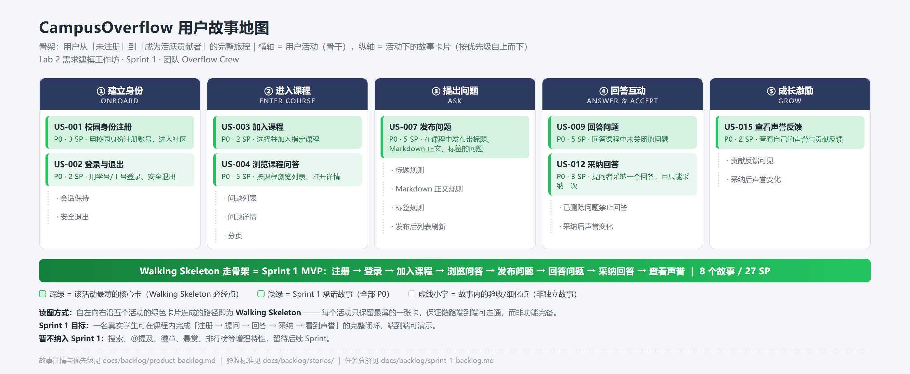

# CampusOverflow 用户故事地图（User Story Map）

> 所属实验：Lab 2 需求建模工作坊（Sprint 1）
> 骨架：用户从「未注册」到「成为活跃贡献者」的完整旅程
> 横轴 = 用户活动（骨干），纵轴 = 活动下的具体故事卡片（按优先级自上而下）

---

## 一、地图总览

| ① 建立身份 | ② 进入课程 | ③ 提出问题 | ④ 回答互动 | ⑤ 成长激励 |
| --- | --- | --- | --- | --- |
| **US-001 校园身份注册** | **US-003 加入课程** | **US-007 发布问题** | **US-009 回答问题** | **US-015 查看声誉反馈** |
| US-002 登录与退出 | US-004 浏览课程问答 | （标题/正文/标签规则） | US-012 采纳回答 | （贡献反馈可见） |
| （会话保持、退出） | （列表、详情、分页） | （发布后列表刷新） | （已删除问题禁止回答） | （采纳后声誉变化） |

---

## 二、骨干活动与故事卡片（纵轴细化）

### ① 建立身份
- **US-001 校园身份注册**（P0，3 点）：用校园身份注册账号，进入社区
- US-002 登录与退出（P0，2 点）：用学号/工号登录、安全退出、会话保持

### ② 进入课程
- **US-003 加入课程**（P0，2 点）：选择并加入指定课程
- US-004 浏览课程问答（P0，5 点）：按课程浏览问题列表、打开详情、分页

### ③ 提出问题
- **US-007 发布问题**（P0，5 点）：在课程中发布带标题、Markdown 正文、标签的问题

### ④ 回答互动
- **US-009 回答问题**（P0，5 点）：回答课程中未关闭的问题
- US-012 采纳回答（P0，3 点）：提问者采纳一个回答，且只能采纳一次

### ⑤ 成长激励
- **US-015 查看声誉反馈**（P0，2 点）：查看自己的声誉与贡献反馈

---

## 三、Walking Skeleton（走骨架）= Sprint 1 MVP

为尽快端到端打通，选取一条**贯穿全部活动、最薄但可运行**的路径作为 Sprint 1 交付：

```
注册(US-001) → 登录(US-002) → 加入课程(US-003) → 浏览列表(US-004)
   → 发布问题(US-007) → 回答问题(US-009) → 采纳回答(US-012) → 查看声誉(US-015)
```

**Sprint 1 目标**：一名真实学生可在课程内完成「注册 → 提问 → 回答 → 采纳 → 看到声誉」的完整闭环，端到端可演示。

> 暂不纳入 Sprint 1：搜索、@提及、徽章、悬赏、排行榜等增强特性（后续 Sprint）。

---

## 四、故事地图图版（PNG）

上两节的表格有一份可直接放进评审幻灯片的图版，绿色卡片即 Sprint 1 承诺的 Walking Skeleton 路径，虚线小字为故事内的验收细化点。



> 图版源：本文档第二、三节内容，经 SM 整理输出；如需更新故事，请先改本文档，再重新生成 `user-story-map.png`，确保图文一致。

---

## 五、MVP 切片说明

- 每个活动只保留**最薄的一张卡片**，保证链路可走通，而非功能完备。
- 非核心交互（如富文本高级编辑、复杂筛选）延后，避免范围蔓延。
- 故事详情与优先级见 [product-backlog.md](product-backlog.md)，验收标准见 [stories/](stories/)。
- Sprint 1 的会议决策与任务分工见 [sprint-1-planning-纪要.md](sprint-1-planning-纪要.md)，任务分解见 [sprint-1-backlog.md](sprint-1-backlog.md)。
