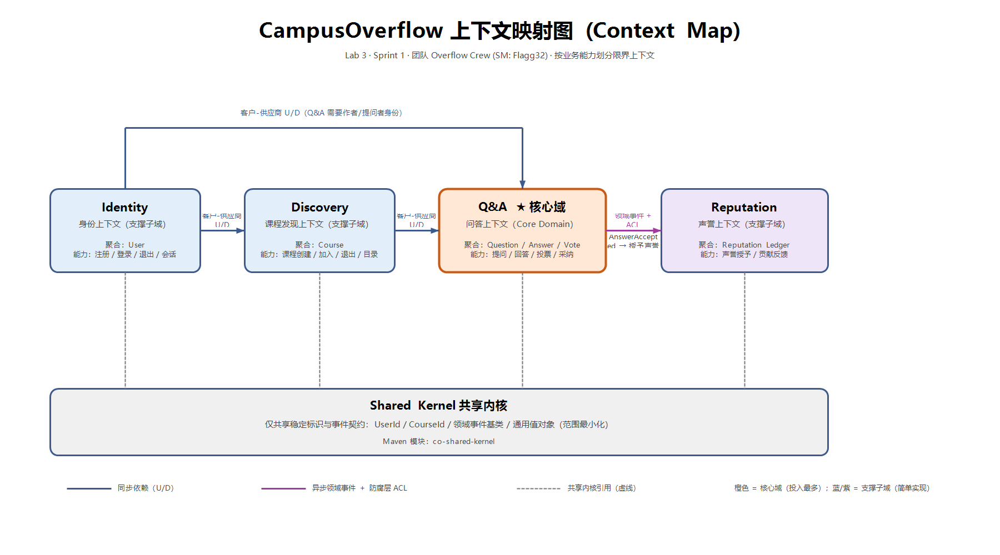
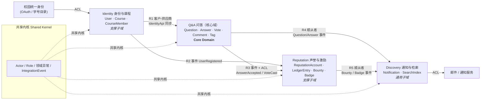

# CampusOverflow 上下文映射图 v1.0（Context Map）

> 所属实验：**Lab 3 领域驱动设计事件风暴**（第 5 周 / Sprint 1）
> 划分原则：**严格按业务能力划分**，不按技术层（数据库 / 前端 / 框架）划分。
> 校验依据：`ArchitectureTest` FF-2 规定「跨上下文只能经由对方的 `api` 包或集成事件」，本图与之一一对应。

---

## 一、子域划分（Subdomain）

| 子域 | 类型 | 业务价值 | 对应限界上下文 |
| --- | --- | --- | --- |
| 问答（Q&A） | **核心域 Core Domain** | 团队差异化竞争力所在：提问、回答、采纳、投票、评论的教学互动闭环 | Q&A |
| 声誉与激励（Reputation） | 支撑子域 Supporting | 用声誉、徽章、悬赏驱动持续贡献，是问答活跃度的杠杆，但规则可复用现成方案 | Reputation |
| 身份与课程治理（Identity） | 支撑子域 Supporting | 校内实名、课程归属与权限判定；其中认证部分接近通用能力 | Identity |
| 通知与检索（Discovery） | 通用子域 Generic | 通知推送、全文检索、相关推荐属于业界成熟能力，优先采购/复用而非自研 | Discovery |

> **结论**：Sprint 1 起把最强人力投入 **Q&A**；Reputation 用现成规则快速补齐；Identity 直接沿用课程提供的参考实现；Discovery 只做最薄的投影。

---

## 二、限界上下文（Bounded Context）

| 限界上下文 | 业务能力 | 核心聚合 | 物理模块 | 对外契约（发布语言） |
| --- | --- | --- | --- | --- |
| **Identity** 身份与课程 | 注册、登录、会话、课程创建与加入、成员角色 | `User`、`Course`、`CourseMember` | `co-identity` | `IdentityApi`、`UserSummary`、`CourseSummary`、`UserRegisteredEvent` |
| **Q&A** 问答（核心域） | 提问、回答、采纳、投票、评论、标签 | `Question`、`Answer`、`Vote`、`Comment`、`Tag` | `co-qa` | `QaQueryApi`、`QuestionRef`、8 类集成事件 |
| **Reputation** 声誉与激励 | 声誉记账、对账、徽章授予、悬赏结算、排行榜 | `ReputationAccount`、`LedgerEntry`、`Bounty`、`BadgeAward` | `co-reputation` | `ReputationApi`、`ReputationSummary`、5 类集成事件 |
| **Discovery** 通知与检索 | 通知生成与已读、全文检索、相关推荐 | `Notification` | `co-discovery` | 无对外 API（纯下游消费者） |
| **Shared Kernel** 共享内核 | 稳定标识、`Actor`、领域异常、集成事件契约、分页 | — | `co-shared-kernel` | `Actor`、`Role`、`DomainException` 族、`IntegrationEvent` |

**装配层**：`co-bootstrap` 不承载业务，只做上下文装配、安全链、发件箱中继与启动入口（不属于任何限界上下文）。

---

## 三、上下文关系

| # | 上游（Upstream） | 下游（Downstream） | 关系模式 | 集成手段 | 说明 |
| --- | --- | --- | --- | --- | --- |
| R1 | Identity | Q&A | **客户-供应商（Customer-Supplier，U/D）** | 同步调用 `IdentityApi` | Q&A 需要作者摘要与「当前用户是否为该课程管理者」的判定，Identity 是供应商 |
| R2 | Identity | Reputation | **事件订阅（发布语言）** | `UserRegisteredEvent` | 用户注册后开立声誉账户并发放初始积分 |
| R3 | Q&A | Reputation | **事件驱动 + 防腐层（ACL）** | `AnswerAccepted`、`VoteCast`、`AnswerSubmitted`、`AnswerEndorsed` | 声誉 listens 事件，由 ACL 翻译为 `ReputationReason` 与 `delta`，不引入 Q&A 的领域模型 |
| R4 | Q&A | Discovery | **顺从者（Conformist，U/D）** | `QuestionPosted`、`QuestionEdited`、`AnswerSubmitted`、`ContentDeleted`、`VoteCast`、`AnswerAccepted` | Discovery 无力议价、也不值得议价，直接遵从 Q&A 的事件契约做投影 |
| R5 | Reputation | Discovery | **顺从者（Conformist，U/D）** | `BountyOpened`、`BountyAwarded`、`BountyClosed`、`BadgeAwarded` | 通知与检索同步消费声誉事件 |
| R6 | 全体上下文 | Shared Kernel | **共享内核（Shared Kernel）** | Maven 依赖 `co-shared-kernel` | 仅共享最稳定的 `Actor`/`Role`/异常/事件基类，**禁止**放入业务概念 |
| R7 | 校园统一身份 | Identity | **防腐层（ACL）** | OAuth / 学号目录适配器 | 校外身份模型不得渗入 `User` 聚合 |
| R8 | Discovery | 邮件 / 短信服务 | **防腐层（ACL）** | `NotificationSender` 端口 + 适配器 | 换成任何服务商不影响领域 |

> **关于第三个「外部系统」定时任务**：事件风暴把「时间」也当作外部触发源（悬赏到期、榜单刷新、账本对账），
> 它没有独立的业务模型、也不与本系统交换数据，因此在上下文映射图中不单独绘制，而是标注在 Reputation 上下文内部。
> 这样既覆盖了事件风暴的识别结果，又不让上下文图出现无意义的方框。

### 关于「伙伴关系（Partnership）」——本次未采用，理由如下

PDF 要求标注四类关系。本项目**明确不使用伙伴关系**，这不是遗漏，而是有意决策：

- 伙伴关系的前提是**两个上下文互相依赖、必须同步演进**（任一方的模型变更都会破坏另一方）。
- 本项目四条跨上下文链路 **R1–R5 全部是单向依赖**：Identity 不知道 Q&A 存在，Q&A 不知道 Reputation 存在。刻意保持单向是模块化单体能长期不腐化的前提。
- 若强行引入伙伴关系（例如让 Reputation 反向调用 Q&A 校验问题状态），会立刻违反 FF-2 架构测试，使 CI 变红。
- **何时应当升级为伙伴关系**：若未来「悬赏规则」需要 Q&A 与 Reputation 共同维护同一套规则对象（如双方共享 `Question` 的采纳语义扩展），则两者应组成伙伴关系并共同排期演进。当前规则全在 `ReputationRulebook` 内，尚不需要。

---

## 四、集成方式与一致性

| 手段 | 使用场景 | 实现要点 |
| --- | --- | --- |
| **发布语言**（`*-api` 包） | 同步只读查询（R1） | `api` 包仅依赖 JDK 与共享内核，可被任何上下文安全引用（FF-5）；内部实现 `IdentityApiImpl` 在 application 层 |
| **集成事件**（事务性发件箱） | 异步通知（R2–R5） | 业务数据与事件在同一本地事务落库 → `OutboxRelay` 轮询投递（`SKIP LOCKED` + 租约）→ 进程内事件总线 |
| **至少一次投递 + 消费端幂等** | 所有异步链路 | 账本唯一键 `uk_ledger_event(event_id,user_id,reason)`、`processed_event` 表 |
| **防腐层** | R3、R7、R8 | 适配器把外部模型翻译为本上下文模型，外部变更不污染领域层 |
| **禁止事项** | 全局 | 不得跨上下文直读对方数据表；不得依赖对方的 `domain`/`application`/`infrastructure`/`interfaces` 包 |

**一致性承诺**：聚合内强一致；跨上下文一律**最终一致**，秒级延迟可接受；声誉以「账本对账任务」（FF-8）作为最终兜底。

---

## 五、Mermaid 版（便于在 GitHub 内直接查看）

---

## 六、常见陷阱自查

| 陷阱 | 本项目的规避方式 |
| --- | --- |
| 按技术分上下文（数据库上下文 / 前端上下文） | 四个上下文均以业务能力命名，物理模块与业务能力一一对应 |
| 上下文太细，退化为「一个聚合一个上下文」 | 同一业务能力内的 5 个聚合（Question/Answer/Vote/Comment/Tag）合并为一个 Q&A 上下文 |
| 上下文之间双向依赖 | R1–R5 全部单向；`ArchitectureTest` FF-2 强制拦截反向依赖 |
| 下游直接读上游数据库表 | 只允许 `api` 包与事件；跨表读取在 CI 中由 ArchUnit 拦截 |
| 共享内核变成"大杂烩" | 共享内核只放 `Actor`/`Role`/异常/事件基类，业务概念一律下沉到各上下文 |

> 术语约定见 [glossary.md](glossary.md)；聚合与不变式见 [aggregates.md](aggregates.md)；事件清单见 [event-storming.md](event-storming.md)。
