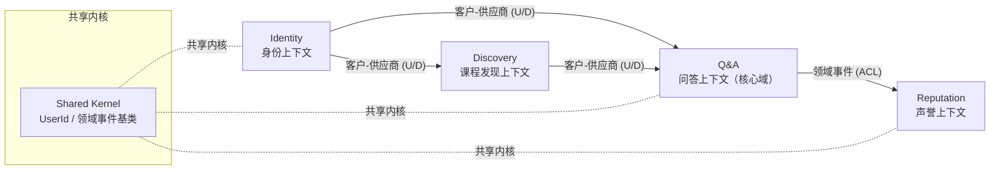

# CampusOverflow 上下文映射图（Context Map）

> 所属实验：Lab 3 领域驱动设计事件风暴（Sprint 1）
> 严格按**业务能力**划分限界上下文，不按技术层（数据库/前端）划分。

---

## 一、限界上下文（Bounded Context）

| 限界上下文 | 业务能力 | 核心聚合 | 对应 Maven 模块 |
| --- | --- | --- | --- |
| Identity 身份上下文 | 注册、登录、退出、会话 | User | co-identity |
| Discovery 课程发现上下文 | 课程创建、加入、退出、课程目录 | Course | co-discovery |
| Q&A 问答上下文（核心域） | 提问、回答、投票、采纳 | Question、Answer、Vote | co-qa |
| Reputation 声誉上下文 | 声誉授予、贡献反馈 | Reputation Ledger | co-reputation |
| Shared Kernel 共享内核 | 共享标识、基础值对象、领域事件基类 | UserId 等 | co-shared-kernel |

---

## 二、上下文映射图

---

## 三、上下文关系说明

| 关系 | 上游 | 下游 | 模式 | 说明 |
| --- | --- | --- | --- | --- |
| Identity → Discovery | Identity | Discovery | 客户-供应商（U/D） | Discovery 依赖 Identity 的用户信息 |
| Identity → Q&A | Identity | Q&A | 客户-供应商（U/D） | Q&A 需要作者/提问者身份 |
| Discovery → Q&A | Discovery | Q&A | 客户-供应商（U/D） | 问题必须归属于一门课程 |
| Q&A → Reputation | Q&A | Reputation | 防腐层 ACL（领域事件） | Q&A 发布 `AnswerAccepted`，Reputation 订阅并授予声誉 |
| 各上下文 ↔ Shared Kernel | — | — | Shared Kernel | 仅共享稳定标识（如 UserId）与事件契约，范围最小化 |

### 集成方式
- **同步查询**：下游通过接口（如 `UserLookupPort`）获取上游只读数据，避免直接读对方表。
- **异步事件**：Q&A 与 Reputation 之间通过领域事件解耦，保证最终一致。
- **防腐层（ACL）**：Reputation 内部用适配器将外部事件翻译为本上下文模型，不被外部模型污染。

---

## 四、关键结论

1. Q&A 是核心域，是团队投入最多、最具差异化的部分。
2. Identity、Discovery 为支撑/通用子域，可优先用简单实现。
3. 声誉通过事件 + ACL 与核心域解耦，避免双向依赖。
4. 物理上对应 Maven 模块，见 [ADR-002](../../docs/adr/ADR-002-package-structure.md)。

> 本图可在 Mermaid 渲染后导出 PNG，作为提交物第 2 项（Context Map PNG）。
