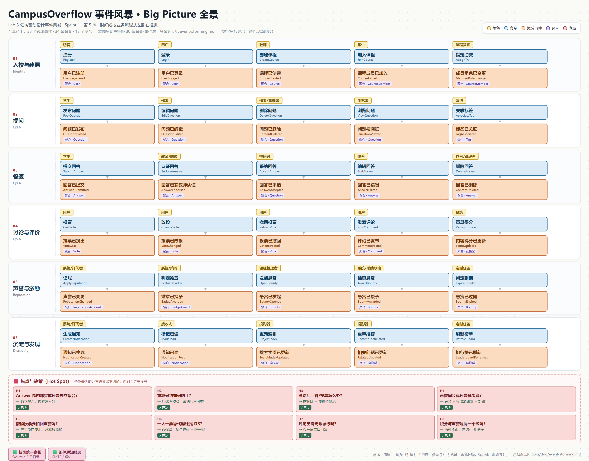

# CampusOverflow 事件风暴（Event Storming）全景记录

> 所属实验：**Lab 3 领域驱动设计事件风暴**（第 5 周 / Sprint 1，2 学时）
> 形式：Big Picture → Process Modeling → Software Design → 上下文映射
> 便利贴约定：🟧 领域事件（过去时） 🟦 命令 🟨 角色 🟩 外部系统 🟪 聚合 🟥 热点
> 现场数字白板：

**本次产出规模**：🟧 领域事件 38 条 · 🟦 命令 34 条 · 🟨 角色 6 类 · 🟩 外部系统 3 个 · 🟪 聚合 13 个 · 🟥 热点 10 个（8 已决 + 2 待办）

---

## 一、Big Picture：领域事件时间线（🟧）

> 命名纪律：**过去时 + 业务术语**。禁止出现"用户操作完成""数据处理完毕"这类抽象事件。
> 标记 `**` 的事件已实现为集成事件（`*-api/event` 包），跨上下文发布。

### 阶段 1｜入校与建课

| # | 领域事件 | English | 说明 |
| --- | --- | --- | --- |
| 1 | 用户已注册 ** | `UserRegistered` | 校园身份落到本系统，产生唯一 `userId` |
| 2 | 用户已登录 | `UserLoggedIn` | 建立服务端会话 |
| 3 | 用户已退出 | `UserLoggedOut` | 会话失效 |
| 4 | 用户已实名认证 | `UserVerified` | 管理员核验学号/工号 |
| 5 | 用户角色已变更 | `UserRoleChanged` | 学生 / 助教 / 教师 / 管理员 |
| 6 | 课程已创建 | `CourseCreated` | 教师建课，建课人自动成为课程教师 |
| 7 | 课程成员已加入 | `CourseJoined` | 学生加入课程，幂等 |
| 8 | 课程成员角色已变更 | `CourseMemberRoleChanged` | 教师指定助教 |

### 阶段 2｜提问

| # | 领域事件 | English | 说明 |
| --- | --- | --- | --- |
| 9 | 问题已发布 ** | `QuestionPosted` | 归属某课程，携带 1–5 个标签 |
| 10 | 问题已编辑 ** | `QuestionEdited` | 仅作者或课程管理者 |
| 11 | 问题已删除 ** | `ContentDeleted` | 软删除，对外不可见 |
| 12 | 问题被浏览 | `QuestionViewed` | 浏览量 +1（反规范化计数） |
| 13 | 标签已关联 | `TagAssociated` | 新标签进入字典，热门标签计数变化 |

### 阶段 3｜答题

| # | 领域事件 | English | 说明 |
| --- | --- | --- | --- |
| 14 | 回答已提交 ** | `AnswerSubmitted` | 问题必须开放 |
| 15 | 回答已编辑 | `AnswerEdited` | 仅作者或课程管理者 |
| 16 | 回答已删除 ** | `ContentDeleted` | 软删除 |
| 17 | 回答已获教师认证 ** | `AnswerEndorsed` | 教师/助教盖章，回答仅一次 |
| 18 | 回答已采纳 ** | `AnswerAccepted` | 每问题仅一次，不可更改 |

### 阶段 4｜讨论与评价

| # | 领域事件 | English | 说明 |
| --- | --- | --- | --- |
| 19 | 投票已投出 ** | `VoteCast` | +1 / −1，不能投自己 |
| 20 | 投票已改投 | `VoteChanged` | 以「新效果 − 旧效果」结算 |
| 21 | 投票已撤回 | `VoteRetracted` | 删除投票记录 |
| 22 | 评论已发布 ** | `CommentPosted` | 一层二级回复 |
| 23 | 内容得分已更新 | `ScoreUpdated` | 计数器投影，非聚合状态 |

### 阶段 5｜声誉与激励

| # | 领域事件 | English | 说明 |
| --- | --- | --- | --- |
| 24 | 声誉账户已开立 | `ReputationAccountOpened` | 注册后开户并发放初始积分 |
| 25 | 声誉已变更 ** | `ReputationChanged` | 每次记账产生一条流水 |
| 26 | 触达每日上限 | `DailyVoteCapReached` | 反作弊：单日正向 ≤ 200 |
| 27 | 徽章已授予 ** | `BadgeAwarded` | 6 类徽章，阈值由策略判定 |
| 28 | 悬赏已发起 ** | `BountyOpened` | 积分 10–500，期限 ≤ 14 天 |
| 29 | 悬赏已授予 ** | `BountyAwarded` | 赢家获得冻结积分，发起人不得自赏 |
| 30 | 悬赏已过期 ** | `BountyExpired` | 到期释放冻结积分 |
| 31 | 悬赏已关闭 ** | `BountyClosed` | 终态，不可再变 |
| 32 | 账本对账已通过 | `ReconciliationPassed` | FF-8：账户值 = 流水累加 |

### 阶段 6｜沉淀与发现

| # | 领域事件 | English | 说明 |
| --- | --- | --- | --- |
| 33 | 通知已生成 | `NotificationCreated` | 被回答 / 被采纳 / 被 @ / 获奖 |
| 34 | 通知已读 | `NotificationRead` | 单条已读 |
| 35 | 通知已全部已读 | `NotificationsAllRead` | 批量已读 |
| 36 | 搜索索引已更新 | `SearchIndexUpdated` | 问题/回答增删改投影进 ngram 索引 |
| 37 | 相关问题已更新 | `RelatedQuestionUpdated` | 标签相似度重算 |
| 38 | 排行榜已刷新 | `LeaderboardRefreshed` | 日 / 周 / 学期榜 |

### 系统边界事件（跨出本系统的"门"）

| 边界事件 | 方向 | 对接方 | 处理方式 |
| --- | --- | --- | --- |
| 校园身份已核验 | 入 | 校园统一身份（OAuth / 学号目录） | Identity 侧 ACL 适配 |
| 邮件/站内信已投递 | 出 | 邮件服务 | Discovery 侧 `NotificationSender` 端口 |
| 悬赏已到期 | 入 | 定时任务（`@Scheduled`） | Reputation 主动扫描 `isDue`，非外部系统回调 |

---

## 二、Process Modeling：角色 → 命令 → 事件（🟨 / 🟦 / 🟩）

> 每条命令都必须能回答"**谁**在**什么权限**下触发"。命令用祈使语气，事件用过去时。

| # | 🟨 角色 | 🟦 命令 | 🟧 产生事件 | 🟪 聚合 | 前置条件 |
| --- | --- | --- | --- | --- | --- |
| 1 | 访客 | 注册 `Register` | UserRegistered | User | 学号唯一、密码合规、🟩 校园身份核验通过 |
| 2 | 用户 | 登录 `LogIn` | UserLoggedIn | User | 账户 ACTIVE、密码正确、未触发登录限流 |
| 3 | 用户 | 退出 `LogOut` | UserLoggedOut | User | 会话存在 |
| 4 | 管理员 | 实名认证 `VerifyUser` | UserVerified | User | 调用者为 ADMIN |
| 5 | 管理员 | 变更角色 `ChangeRole` | UserRoleChanged | User | 调用者为 ADMIN |
| 6 | 教师/管理员 | 创建课程 `CreateCourse` | CourseCreated | Course | 调用者为 TEACHER/ADMIN |
| 7 | 学生 | 加入课程 `JoinCourse` | CourseJoined | CourseMember | 课程存在、未重复加入 |
| 8 | 课程教师 | 指定助教 `AssignTA` | CourseMemberRoleChanged | CourseMember | 调用者为该课程 TEACHER |
| 9 | 学生 | 发布问题 `PostQuestion` | QuestionPosted | Question | 已加入课程、标题/正文合规、1–5 个标签 |
| 10 | 作者/管理者 | 编辑问题 `EditQuestion` | QuestionEdited | Question | 作者或课程管理者、未删除 |
| 11 | 作者/管理者 | 删除问题 `DeleteQuestion` | ContentDeleted | Question | 提问者仅可删无回答的问题 |
| 12 | 浏览者 | 浏览问题 `ViewQuestion` | QuestionViewed | Question | — |
| 13 | 学生 | 提交回答 `SubmitAnswer` | AnswerSubmitted | Answer | 问题未被删除 |
| 14 | 作者/管理者 | 编辑回答 `EditAnswer` | AnswerEdited | Answer | 作者或课程管理者、未删除 |
| 15 | 作者/管理者 | 删除回答 `DeleteAnswer` | ContentDeleted | Answer | 作者或课程管理者 |
| 16 | 教师/助教 | 认证回答 `EndorseAnswer` | AnswerEndorsed | Answer | 具备课程管理权限、该回答未认证 |
| 17 | 提问者/管理者 | 采纳回答 `AcceptAnswer` | AnswerAccepted | Question | 未采纳过、回答属于该问题且未删除 |
| 18 | 用户 | 投票 `CastVote` | VoteCast | Vote | 不是自己的内容、该内容未投过票 |
| 19 | 用户 | 改投 `ChangeVote` | VoteChanged | Vote | 已投过票 |
| 20 | 用户 | 撤回投票 `RetractVote` | VoteRetracted | Vote | 已投过票 |
| 21 | 用户 | 发表评论 `PostComment` | CommentPosted | Comment | 内容 1–1000 字、回复层级 ≤ 1 层 |
| 22 | 系统（事件订阅者） | 记账 `ApplyReputation` | ReputationChanged | ReputationAccount + LedgerEntry | 同一来源事件未入账过（幂等） |
| 23 | 系统（事件订阅者） | 开立账户 `OpenAccount` | ReputationAccountOpened | ReputationAccount | 收到 UserRegistered |
| 24 | 系统（策略） | 判定徽章 `EvaluateBadge` | BadgeAwarded | BadgeAward | 累计指标达阈值、该徽章未授予 |
| 25 | 课程管理者 | 发起悬赏 `OpenBounty` | BountyOpened | Bounty | 问题开放中、积分 10–500、期限 ≤ 14 天、积分足额 |
| 26 | 系统（采纳联动） | 结算悬赏 `AwardBounty` | BountyAwarded | Bounty | 问题被采纳、赢家 ≠ 发起人、状态为 OPEN |
| 27 | 定时任务 | 判定到期 `ExpireBounty` | BountyExpired | Bounty | `now > expiresAt` 且状态 OPEN |
| 28 | 系统（事件订阅者） | 生成通知 `CreateNotification` | NotificationCreated | Notification | 同一事件对同一接收人未生成过 |
| 29 | 接收人 | 标记已读 `MarkNotificationRead` | NotificationRead | Notification | 通知属于本人 |
| 30 | 接收人 | 全部已读 `MarkAllRead` | NotificationsAllRead | Notification | — |
| 31 | 系统（投影器） | 更新索引 `ProjectSearchIndex` | SearchIndexUpdated | SearchIndex（读模型） | 收到问题/回答/投票事件 |
| 32 | 系统（投影器） | 重算相关推荐 `RecomputeRelated` | RelatedQuestionUpdated | RelatedQuestion（读模型） | 标签集合变化 |
| 33 | 系统（定时任务） | 刷新排行榜 `RefreshLeaderboard` | LeaderboardRefreshed | Leaderboard（读模型） | 按日/周/学期窗口 |
| 34 | 系统（定时任务） | 对账 `ReconcileLedger` | ReconciliationPassed / ReconciliationDrifted | ReputationAccount | 账户值 ≠ 流水和则告警 |

### 🟩 外部系统

| 外部系统 | 交互 | 防腐层 |
| --- | --- | --- |
| 校园统一身份（OAuth / 学号目录） | 注册与登录时核验校园身份 | `Identity` 侧适配器，校外模型不进入 `User` |
| 邮件 / 短信 / 站内信服务 | 重要通知的二次触达 | `Discovery` 的 `NotificationSender` 端口 |
| 定时任务调度（Quartz / Spring Scheduler） | 悬赏到期、排行榜刷新、账本对账、索引重建 | 视为"时间"这一外部触发源，独立成命令 |

---

## 三、Software Design：命令-事件聚类为聚合（🟪）

> 聚类判据：**若两条命令必须同时成立才合法，则落在同一聚合**；否则拆开，用事件对齐。

| 🟪 聚合 | 聚类到的命令 | 所属上下文 | 选它的理由 |
| --- | --- | --- | --- |
| `User` | Register / LogIn / LogOut / Verify / ChangeRole | Identity | 身份状态必须唯一且强一致 |
| `Course` | CreateCourse | Identity | 课程代码 + 学期唯一性 |
| `CourseMember` | JoinCourse / AssignTA | Identity | 成员关系独立演进，避免撑大课程聚合锁范围 |
| `Question` | PostQuestion / Edit / Delete / AcceptAnswer | Q&A | 采纳唯一性是核心不变式，必须在单事务内判定 |
| `Answer` | SubmitAnswer / Edit / Delete / Endorse | Q&A | 高并发写入，独立聚合避免锁竞争 |
| `Vote` | CastVote / ChangeVote / RetractVote | Q&A | 一人一票需强一致，跨问题/回答通用 |
| `Comment` | PostComment | Q&A | 层级约束需在写入时判定 |
| `Tag` | TagAssociated | Q&A | 标签字典去重；计数走读模型 |
| `ReputationAccount` | ApplyReputation / OpenAccount | Reputation | 余额与冻结额必须守恒 |
| `LedgerEntry` | 记账（随 ApplyReputation 同事务） | Reputation | 只追加、幂等键去重 |
| `Bounty` | OpenBounty / AwardBounty / ExpireBounty | Reputation | 状态机终态唯一，重复结算必须被拒 |
| `BadgeAward` | EvaluateBadge | Reputation | 同徽章仅一次 |
| `Notification` | CreateNotification / MarkRead / MarkAllRead | Discovery | 幂等 + 已读状态 |

### 读模型（Read Model）

| 读模型 | 为什么需要 | 数据来源 |
| --- | --- | --- |
| 课程问题列表 | 列表页需要回答数/得分/是否已解决，跨 3 个聚合，不能实时 join | 问题/回答/投票事件投影 |
| 问题详情视图 | 作者信息跨上下文，须合并 Identity 只读接口 | Question + `IdentityApi` |
| 热门标签 | 需按使用频次排序 | 标签计数投影 |
| 排行榜 | 跨用户聚合排名，实时计算代价高 | 声誉事件累计 |
| 搜索索引 | 中文全文检索（ngram），关系库不适合 | 问题/回答事件投影 |
| 相关问题 | 标签相似度计算，查询期算不动 | 索引重建任务 |
| 未读通知计数 | 顶栏红点高频读取 | 通知状态计数 |

---

## 四、热点（Hot Spot 🟥）与决策记录

> 热点是团队争论最久、最容易出错的地方。每条都必须留下**结论**，否则事件风暴等于没开。

| # | 热点 | 争论 | 决策 | 状态 |
| --- | --- | --- | --- | --- |
| H1 | Answer 是 Question 的内部实体，还是独立聚合？ | 内部实体保证采纳强一致，但锁范围大 | **独立聚合**，采纳时显式加载并校验归属，仍在 Question 事务内 | ✅ 已决（ADR 记录） |
| H2 | 重复采纳如何防止？ | 前端置灰 vs 后端强校验 | **后端强校验**：`acceptedAnswerId != null` 即抛冲突；前端只是体验优化 | ✅ 已决 |
| H3 | 问题被删除后，回答与投票怎么办？ | 级联物理删除 vs 保留 | **软删除 + 读模型过滤**，保留审计与声誉依据 | ✅ 已决（ADR-006） |
| H4 | 声誉是同步算还是异步算？ | 同步简单但耦合，异步解耦但可能滞后 | **异步 + 只追加账本 + 对账任务兜底** | ✅ 已决（ADR-004） |
| H5 | 撤销投票要不要扣回已发的声誉？ | 不扣则刷分，扣则流水变复杂 | **按增量结算**：撤销产生负向流水，账本永远只追加 | ✅ 已决 |
| H6 | 一人一票靠代码还是靠数据库？ | 代码够用？ | **双保险**：聚合内校验 + DB 唯一键 (voter,target_type,target_id) | ✅ 已决 |
| H7 | 评论支持无限层级吗？ | 无限层级像论坛，但查询与 UI 复杂 | **仅一层二级回复**，父评论不能是回复 | ✅ 已决 |
| H8 | 悬赏积分与声誉是同一个数吗？ | 混用简单 | **两种货币**：声誉只读荣誉值，积分可用于悬赏；冻结/可用分离 | ✅ 已决 |

### 尚未闭环的热点（进入 Sprint Backlog）

| # | 待办 | 归属 |
| --- | --- | --- |
| H9 | 教师认证（endorse）是否也加声誉分？当前规则手册未覆盖 | Reputation，Sprint 3 讨论 |
| H10 | 每日上限按 UTC 自然日，跨时区学生体验是否公平 | Reputation，Sprint 4 复盘 |

---

## 五、阶段结论

1. **事件全部使用业务语言**，可直接映射为 `*-api/event` 包中的集成事件类，命名一一对应。
2. **13 个聚合落在 4 个限界上下文**，问答上下文聚合最多（5 个），与"核心域投入最多"的判断一致。
3. **强一致只发生在聚合内**；跨聚合、跨上下文一律事件驱动 + 幂等消费 + 对账兜底。
4. 上下文关系与物理模块的映射见 [context-map.md](context-map.md) 与 [context-map.png](context-map.png)。
5. 聚合不变式清单见 [aggregates.md](aggregates.md)，术语见 [glossary.md](glossary.md)。

---

## 附：便利贴颜色与产出物对照

| 颜色 | 语义 | 本次数量 | 落在哪个文档 |
| --- | --- | --- | --- |
| 🟧 橙 | 领域事件 | 38 | 本文第一节 |
| 🟦 蓝 | 命令 | 34 | 本文第二节 |
| 🟨 黄 | 角色 | 6 类（访客/学生/教师/助教/管理员/系统） | 本文第二节 |
| 🟩 绿/粉 | 外部系统 | 3 | 本文第二节末 |
| 🟪 紫 | 聚合 | 13 | 本文第三节 + aggregates.md |
| 🟥 红 | 热点 | 10（8 已决 + 2 待办） | 本文第四节 |
